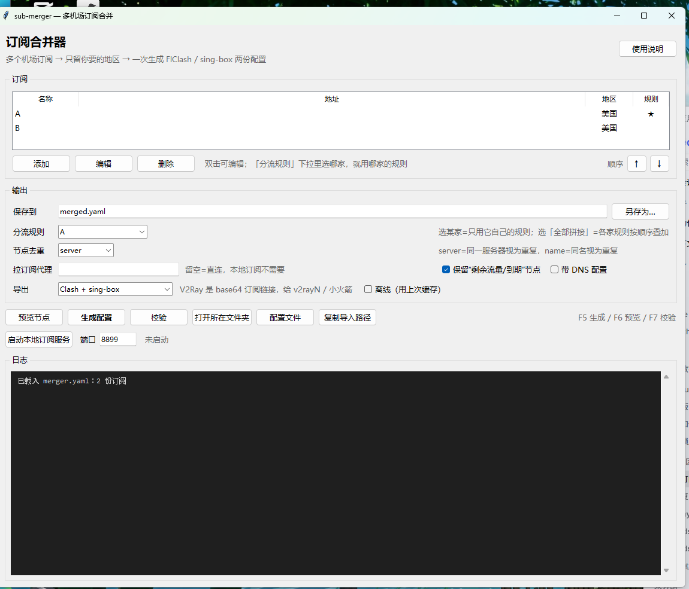

# sub-merger — 多机场订阅合并器（Clash / sing-box / V2Ray）

[](https://github.com/oshuke/sub-merger/actions/workflows/tests.yml)
[](LICENSE)
[](https://www.python.org/)



把多个机场订阅合成**一份**配置：节点池合并、只保留你要的地区、策略组精简成三个，再按需导出成 Clash、sing-box 或 V2Ray 订阅。

- 输入：若干 Clash 订阅链接（命令行也支持本地 yaml）
- 输出：默认落在「下载/订阅导出」里——`merged.yaml`（Clash/FlClash）、`merged-singbox.json`、`merged-v2ray.txt`（base64 订阅），外加一份统计报告；生成成功后会自动打开这个文件夹
- 额外：`--serve` 起本地订阅地址，让 FlClash 定时自动刷新

## English (short)

**sub-merger** merges several proxy-airport subscriptions into one config file. It keeps only the nodes you want (region preset, regex, keep/drop lists or an interactive picker), rebuilds three simple proxy groups, and exports any of:

| format | file | used by |
|---|---|---|
| Clash / mihomo YAML | `merged.yaml` | FlClash, Clash Verge, mihomo |
| sing-box JSON | `merged-singbox.json` | sing-box (1.12+) |
| V2Ray base64 subscription | `merged-v2ray.txt` | v2rayN, NekoBox, Shadowrocket |

- GUI (tkinter) or CLI, Python 3.8+, only PyYAML as a dependency
- Optional local subscription server (`--serve`) so clients can auto-refresh
- Your config never leaves your machine; `merger.yaml` and every generated file are git-ignored because they contain subscription URLs with tokens

Quick start: `pip install pyyaml` then `python gui.py` (Windows users can double-click `启动界面.bat`).

## 能做什么

| 能力 | 说明 |
|---|---|
| 多订阅合并 | 每家一个 `name`，节点自动加 `[A] ` 前缀，同名再加 ` #2`；跨订阅按服务器去重 |
| 只留某地区 | 「地区预设」一键（美国/日本/香港/新加坡/台湾），或「自定义」写正则；另有排除正则 |
| 规则来源可挑 | 用某一家的规则集，或各家规则按顺序拼接（顺序可调） |
| 三种格式导出 | Clash YAML / sing-box JSON / V2Ray base64 订阅，可单选也可全要 |
| 自动更新 | 本地订阅服务 + FlClash 定时刷新，或直接重跑生成文件 |
| 离线兜底 | 勾「离线（用上次缓存）」，订阅站挂了也能出配置 |

## 为什么不能“两家规则都保留”

一条连接只走一条规则链，按顺序命中即停，`MATCH` 只能有一个。把 A、B 的规则拼起来，B 的规则基本永远轮不到。所以规则来源有两档（配置里是 `output.rule_mode`）：

| 模式 | 规则来源 | 适用 |
|---|---|---|
| `primary`（默认） | 只留主订阅（★）的规则，末尾补 `MATCH,PROXY` | 想要「合并=冗余」，A 挂了规则自动走 B 的节点 |
| `union` | 各家规则依次拼接（非主订阅的 `MATCH` 丢弃、`rule-providers` 改名） | 两家规则风格接近，愿意接受先到先得 |

节点和策略组本身没有冲突，合并是无损的；按你选的方案，策略组会被重建成精简的三个。

## 环境

Python 3.8+，只依赖 PyYAML：

```bash
pip install pyyaml
```

## 图形界面（推荐）

双击 **`启动界面.bat`**，或者：

```bash
python gui.py
```

界面和命令行读写同一份 `merger.yaml`，做的事完全一样。

**订阅区**

- `添加` 填 Clash 订阅链接（只收 `http`/`https`，v2ray/base64 订阅请先用机场的 Clash 链接）
- 双击任意行编辑，`删除` 移除
- `↑` `↓` 调整顺序：`全部拼接` 模式下按这个顺序命中
- 「地区预设」选美国就只留美区；选「自定义」自己写正则；「排除正则」用来扔掉不想要的节点

**输出区**

- `保存到`：输出路径（默认 `下载/订阅导出/merged.yaml`，另外两个文件跟它同名不同后缀；`另存为…` 可换位置）
- `分流规则`：下拉选某家（用它的规则）或「全部拼接（union）」
- `导出`：`Clash + sing-box` / `Clash + sing-box + V2Ray（全要）` / `只要 Clash` / `只要 sing-box` / `只要 V2Ray`
- `节点去重`：`server`（同服务器算重复）或 `name`（同名算重复）
- `拉订阅代理`：本机 FlClash 开着就填 `http://127.0.0.1:7890`，留空=直连
- 勾选项：保留“剩余流量/到期”节点、带 DNS 配置、离线（用上次缓存）

**按钮与快捷键**

- `预览节点`（F6）：只拉节点不写文件，看每家保留多少
- `生成配置`（F5）：写文件 + 日志统计
- `校验`（F7）：检查已生成配置的引用是否自洽
- `打开所在文件夹`、`配置文件`（直接打开 merger.yaml）、`复制导入路径`
- `启动本地订阅服务`：起 `http://127.0.0.1:8899/sub`（Clash）/ `/sub.json`（sing-box）/ `/sub.txt`（V2Ray、小火箭），并自动复制 `/sub` 地址
- `F1` 使用说明；日志区右键可「复制全部 / 清空日志」

## 快速开始（命令行）

```bash
# 1. 复制配置，填订阅
cp merger.example.yaml merger.yaml

# 2. 生成（联网拉订阅）
python merger.py -c merger.yaml

# 3. 校验
python merger.py -c merger.yaml --check
```

输出 `merged.yaml`、`merged-singbox.json`、`merged-v2ray.txt`、`merged-report.md`（每家保留多少、去重多少、规则重映射情况）。

## 配置

`merger.yaml` 主要三块：

```yaml
subscriptions:
  - name: A              # 前缀，最终节点名是 "[A] 🇺🇸洛杉矶01"
    url: "https://.../subscribe?token=..."
    primary: true        # 规则以它为准（primary 模式）
    filter: '(?i)(美国|🇺🇸|洛杉矶|...)'
    exclude: ''          # 额外剔除
  - name: B
    url: "https://.../subscribe?token=..."
    filter: '(?i)(美国|...)'

output:
  path: ""            # 留空=下载/订阅导出/merged.yaml
  rule_mode: primary     # primary | union
  group_entry: PROXY     # 入口组名（select，默认选“自动选择”）
  group_auto: 自动选择    # url-test，interval/tolerance 可调
  group_manual: 手动选择
  dedupe: server         # server=同服务器+端口+密码算重复；name=按名字
  include_dns: false
  tun_stack: system      # sing-box tun 栈：system / gvisor / mixed
  clash: true            # 导出 Clash YAML
  singbox: true          # 导出 sing-box JSON
  v2ray: false           # 导出 V2Ray base64 订阅
  singbox_path: ""       # 留空=与 path 同目录
  v2ray_path: ""         # 留空=与 path 同目录
```

完整字段见 `merger.example.yaml` 注释。

订阅格式：**Clash YAML**。`url` 返回 base64 的 v2ray/ss 订阅会直接报错——那种先用机场的「Clash 订阅」链接。

## 三种输出怎么用

**Clash（`merged.yaml`）** — FlClash / mihomo / Clash Verge

- FlClash：`配置` → 右上角 `+` → 从文件导入 → 选它
- 想自动更新：界面点 `启动本地订阅服务`，`+` → 从 URL 导入 `http://127.0.0.1:8899/sub`
- sing-box 客户端填同端口的 `http://127.0.0.1:8899/sub.json`，v2rayN / 小火箭填 `/sub.txt`（base64 订阅）

**sing-box（`merged-singbox.json`）**

- 结构：`PROXY`(selector) → `自动选择`(urltest) / `手动选择`(selector) / `direct`，后面跟全部节点
- 自带 `tun` + `mixed(127.0.0.1:2080)` 两个入站；客户端自己开 TUN 的话删掉 `tun-in` 那段
- TUN 默认用 `stack: system`（官方有些构建没带 gVisor，`mixed`/`gvisor` 会 FATAL：`gVisor is not included in this build`）。要换就改配置 `output.tun_stack: gvisor`
- 规则只有 `ip_is_private → direct` 和 `final: PROXY`，**没有**把机场分流规则翻译过来；要在 sing-box 里分流得自己写 `route.rules`
- DNS 段用 sing-box **1.12+ 的新写法**（`{"type": "udp"|"https", "server": …}`），并带上 `route.default_domain_resolver`，可在 1.14 / 1.15 上直接 `sing-box check` 通过；老版本 1.11 及以前不认这种写法
- 支持 ss / vmess / vless / trojan / hysteria2 / tuic / socks / http，含 ws / grpc / h2、TLS / REALITY / uTLS 字段
- 不支持的类型会被跳过并在日志里报数量：`ssr`、hysteria v1、`wireguard`、`snell`

**V2Ray（`merged-v2ray.txt`）**

- 内容是 base64 编码的分享链接列表，等价于一份订阅
- 怎么用：在 v2rayN / nekobox / 小火箭里「从剪贴板导入」或把这个文件当订阅内容；也可以把它放到任意静态服务器上当订阅 URL
- 支持：`vmess://`、`vless://`、`trojan://`、`ss://`、`hysteria2://`、`tuic://`、`socks5://`、`http://`

## 手动筛选（三层，可叠加）

1. **正则**：配置里的 `filter` / `exclude`（界面里是「地区预设 / 过滤正则 / 排除正则」）
2. **名单文件**：`keep.txt` / `drop.txt`，一行一个节点名，支持 `*` 通配，也支持 `A::节点名` 只对某家生效。keep 非空时只留命中的，drop 优先级高于 keep
3. **交互式挑选**：

   ```bash
   python merger.py -c merger.yaml --pick
   # 列出所有节点编号，输入 1,3-5,8 这样的选择，结果写进 keep.txt
   ```

## 让 FlClash 自动刷新（推荐）

```bash
python merger.py -c merger.yaml --serve 127.0.0.1:8899
```

FlClash → 配置 → `+` → 从 URL 导入：`http://127.0.0.1:8899/sub`

- 服务每 `refresh_seconds`（默认 1800 秒）重新拉订阅合并一次
- 加 `--offline` 只用缓存，适合断网或订阅挂了的时候
- 不想常驻：直接生成文件，FlClash 里「从文件导入」，需要时重跑再点更新

Windows 开机自启（计划任务示例，按实际路径改）：

```powershell
schtasks /create /tn "sub-merger" /sc onlogon /rl highest /tr "C:\\Python312\\pythonw.exe C:\\path\\to\\sub-merger\\merger.py -c C:\\path\\to\\merger.yaml --serve 127.0.0.1:8899"
```

## 其它命令

```bash
python merger.py -c merger.yaml --offline     # 不联网，用 .cache 里的订阅
python merger.py -c merger.yaml --check       # 只校验已有输出，不重新合并
python merger.py -c merger.yaml --list        # 只打印过滤后的节点，不写文件
python merger.py -c merger.yaml -o D:/out.yaml --report D:/report.md   # 自定义输出/报告路径
```

## 它会怎么改你的配置

- 节点：`[A] 原名`，同名自动加 ` #2`；跨订阅按服务器去重
- 策略组：重建为 `PROXY`(select) / `自动选择`(url-test) / `手动选择`(select)
- 规则：target 重映射 —— “自动/故障转移/负载…”→`自动选择`，“节点选择/手动/入口…”→`手动选择`，美国相关组→`自动选择`，其余→`PROXY`；直连/拒绝保留；末尾补 `MATCH,PROXY`
- `port` / `tun` / `external-controller` 一律不写，交客户端自己管

## 已知限制

- 订阅必须是 Clash YAML；base64 的 v2ray 订阅不能直接当输入（但可以当输出）
- `RULE-SET` 的规则集文件由客户端自己下载（`keep_rule_providers: true` 时保留原 `rule-providers`）
- 机场自带的“剩余流量/套餐到期”节点默认保留（有的机场做成了真节点），要丢就把 `defaults.drop_info_nodes` 设 true
- sing-box / V2Ray 输出都**不搬分流规则**：sing-box 固定 `final: PROXY`，V2Ray 订阅里根本没有规则这个概念
- sing-box 不支持 `ssr`、hysteria v1、`wireguard`、`snell`；V2Ray 输出对这些类型同样会跳过
- 目前只做“合并 + 精简组”，不做节点测速排序、不做流量统计
- 订阅链接里的中文域名会被自动转成 punycode 再请求；转完仍连不上，多半是被墙，填「拉订阅代理」

## 安全提醒

`merged.yaml`、`merged-singbox.json`、`merged-v2ray.txt`、`merged-report.md` 里都有节点完整凭据（uuid/密码/服务器地址），**别提交到仓库、别发群里**。`merger.yaml` 里的订阅链接同理（日志里会 `mask_url`，但文件里是明文）。

## 开发与发布

```bash
python tests/selftest.py                      # 单元自测
python merger.py -c tests/merger.test.yaml -o dist/merged.yaml   # 用夹具跑一遍完整流程
python scripts/build_release.py --version v0.1.0                 # 打出 dist/sub-merger-v0.1.0.zip
```

CI 在 `.github/workflows/tests.yml`：Python 3.9 / 3.11 / 3.12 上做编译检查、自测和夹具冒烟。

## License

MIT，见 [LICENSE](LICENSE)。
